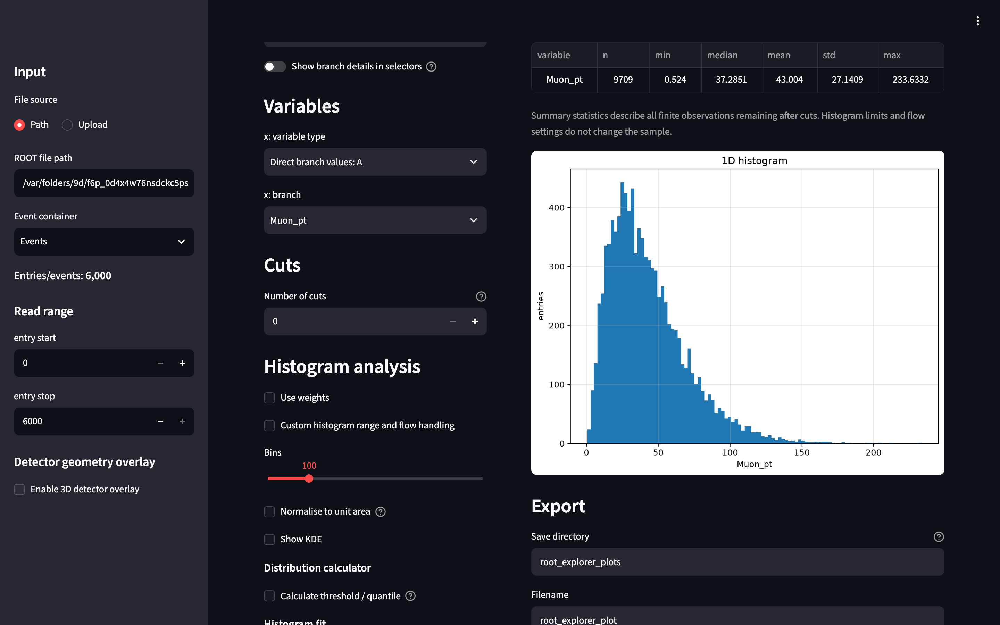

<p align="center">
  
</p>

# ROOT Explorer

**Explore HEP ROOT files directly in your browser.** ROOT Explorer is an interactive Streamlit app for browsing TTrees, RNTuples and stored ROOT objects, making plots, fitting histograms and inspecting individual events.

**[Documentation](https://root-explorer.readthedocs.io/)** · **[Source](https://github.com/AlexanderPeschBerrocal/root-explorer)** · **[Issues](https://github.com/AlexanderPeschBerrocal/root-explorer/issues)**



## Features

- Browse TTrees, RNTuples, histograms, profiles and graphs.
- Plot branches and jagged particle collections with cuts, weights and derived variables.
- Make histograms, scatter plots and fits; inspect and rank individual events.
- Download figures and standalone Python scripts that reproduce them.

## Quick start

```bash
docker run --rm -p 127.0.0.1:8501:8501 ghcr.io/alexanderpeschberrocal/root-explorer:stable
```

Open <http://localhost:8501> and choose **Upload** to open a ROOT file, then follow [Your first plot](https://root-explorer.readthedocs.io/en/latest/getting-started.html). To install from source with Python 3.12, and for all other options, see [Installation](https://root-explorer.readthedocs.io/en/latest/installation.html).

## Contributing and licence

See [Development and contributing](https://root-explorer.readthedocs.io/en/latest/contributing.html). ROOT Explorer is licensed under the [BSD 3-Clause Licence](https://github.com/AlexanderPeschBerrocal/root-explorer/blob/main/LICENSE); see also the [third-party notices](https://github.com/AlexanderPeschBerrocal/root-explorer/blob/main/THIRD_PARTY_NOTICES.md).
