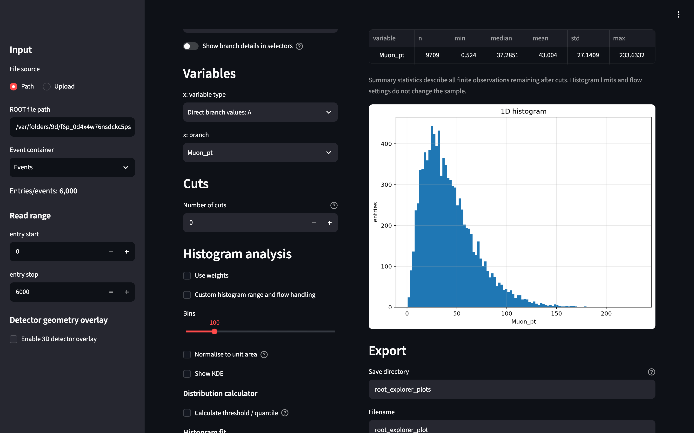

<p align="center">
  
</p>

# ROOT Explorer

**Explore HEP ROOT files directly in your browser.** ROOT Explorer is an interactive Streamlit app for browsing TTrees, RNTuples and persisted ROOT objects, making plots, fitting histograms and inspecting individual events.

**[Documentation (source)](docs/source/index.rst)** · **[Source](https://github.com/AlexanderPeschBerrocal/root-explorer)** · **[Issues](https://github.com/AlexanderPeschBerrocal/root-explorer/issues)**



## What can it do?

- Inspect TTrees, RNTuples, ROOT histograms, profiles and graphs.
- Plot scalar branches and jagged particle collections, with cuts, weights and derived observables.
- Create 1D and 2D histograms, scatter plots, density displays, KDEs and least-squares fits.
- Inspect and rank events, or overlay supported GDML geometry on 3D scatter plots.
- Download figures and standalone Python plotting scripts for reproducible follow-up analysis.

## Quick start

Run the published Docker image:

```bash
docker run --rm -p 8501:8501 ghcr.io/alexanderpeschberrocal/root-explorer:stable
```

Open [http://localhost:8501](http://localhost:8501). Use **Upload** to select a ROOT file from your computer. For local paths and reproducible deployments, consult [installation and Docker](docs/source/installation.md). A versioned image tag is recommended in production.

For Python 3.12 source installation, development, and scientific explanations of histogram statistics and fitting, use the [documentation in this repository](docs/source/index.rst).
The public Read the Docs URL will be added after the hosting project is registered and its first build verified.

## Licence

ROOT Explorer is licensed under the [BSD 3-Clause Licence](LICENSE). See [third-party notices](THIRD_PARTY_NOTICES.md).
