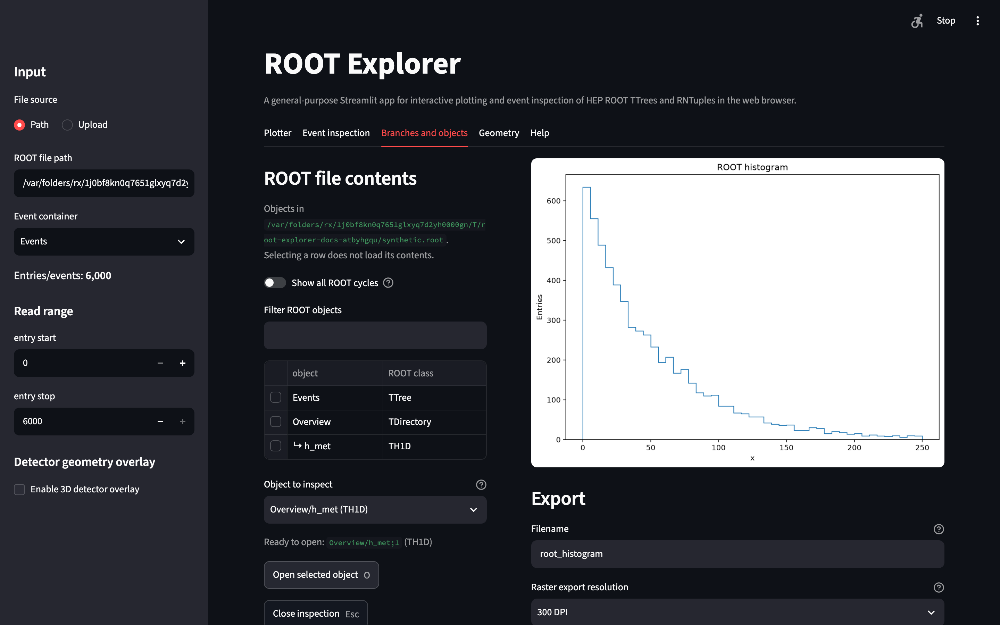

# ROOT files, event containers and persisted objects

A ROOT file may contain multiple kinds of objects. ROOT Explorer exposes two related but distinct workflows:

- **Event-data exploration:** Select a TTree or RNTuple containing entries/events, choose a read range and plot branches (fields) from those entries.
- **Persisted-object inspection:** Browse a ROOT file's existing stored histograms, graphs and profiles. These objects are not created afresh from event branches by ROOT Explorer.

## Choose a TTree or RNTuple

Open a ROOT file using the sidebar's **Path** or **Upload** input. If the file contains event data, choose an **Event container**. Select **entry start** and **entry stop** to define the half-open interval of entries to inspect (the stop value is exclusive).

A typical NanoAOD-like `Events` tree has scalar event branches such as `MET_pt` or `nMuon`, as well as jagged particle fields such as `Muon_pt`. See [Variables and collections](variables-and-collections.md) for interpretation.

Use the tab containing event-container fields to inspect names, types and per-entry structure. ROOT Explorer distinguishes scalars, fixed-size fields, jagged fields and nested/record structures; not every source type is directly plottable.

## Browse stored ROOT objects

Use the **ROOT objects** browser to view objects and their directory paths without immediately loading all their contents. Search/filter the catalogue, select an inspectable object and click **Open selected object**. The fallback **Object to inspect** selector can be used when browser row selection is unavailable.

ROOT Explorer supports dedicated inspection workflows for supported stored histogram and graph classes, including 1D/2D histograms, profiles and TGraphs. Specific capabilities depend on the object's ROOT class and dimensionality: a TProfile contains per-bin means, **not** event-count histogram yields. Histogram-only operations should not be assumed valid for profiles or graphs.

A ROOT file that contains **no TTree or RNTuple** can still be opened in the ROOT-object browser. Objects may reside in nested ROOT directories, and ROOT object cycles can be shown if needed.

## What is loaded?

Browsing object metadata is different from opening the object or loading data for a plot. Use entry ranges for large event datasets and keep object inspection deliberate to reduce unnecessary memory use.

Next: [Plotting](plotting.md).
