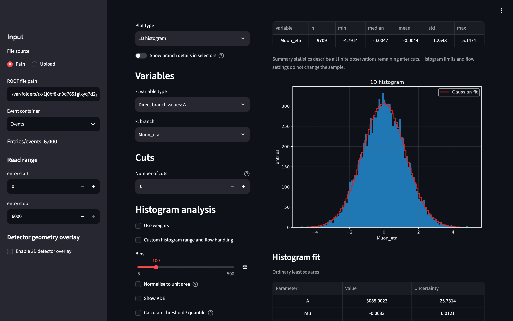

# Histogram statistics, normalisation and fitting

This chapter covers histograms **computed from events**, and where explicitly
noted, persisted ROOT histograms. Histogram operations affect physical and
statistical interpretation: a displayed bin height is not always a count.



## Counts, weights and statistical uncertainty

An unweighted bin yield counts selected observations; for a jagged branch,
these can be *objects*, rather than *events*. For weighted yields, the bin
content is the sum of weights, \(\sum_i w_i\), and stored per-bin variance
is typically \(\sum_i w_i^2\), not \(\sum_i w_i\).
Negative generator weights allow negative bin sums. The resulting yield
need not be a probability distribution; never apply ordinary Poisson
count formulas indiscriminately to weighted histograms.

Statistics describing the selected sample are calculated after selection
and are not redefined by histogram range, zoom, or flow display settings.
If your physics selection changes, regenerate the plot.

The following sections retain the detailed mathematical and implementation
constraints originally documented in the README.

## Unit-area density normalisation

For event-derived **1D histograms**, enable **Normalise to unit area** under
Histogram analysis. The displayed histogram is a bin-width-corrected density:

```text
density[i] = sum_weights[i] / (normalisation_sum * bin_width[i])
sum_i density[i] * bin_width[i] = 1
```

The operation is performed after variable evaluation, selections, non-finite
filtering and optional event weights. **Ignore** normalises using only nominal
in-range bins, producing a conditional in-range density. **Fold** first moves
underflow and overflow yields into the corresponding edge bins and then includes
them in normalisation; the edge-bin density is therefore a visualisation of
folded yields, not a local density estimate of the original out-of-range data.
**Show separate bins** cannot be combined with density mode because flow
categories do not have finite widths. Axis zoom does not affect the
normalisation domain.

Unweighted and weighted histograms use their visible bin sums as denominators.
For signed weights, a positive net integral produces a *signed unit-integral
density*, which need not be non-negative or interpretable as a probability
distribution. Empty, non-positive or numerically unstable denominators leave
the original yields visible with a warning. Original sample statistics and
flow tables are unchanged. The y-axis defaults to **Normalised density**;
for an observable measured in GeV, the physical density unit is GeV⁻¹.

For a fixed denominator `S`, stored variances are rescaled by
`1 / (S * bin_width[i])**2`. Since the denominator is estimated from the
same data, these diagonal variances do not capture the full covariance of a
self-normalised distribution. They must not be treated as independent
statistical uncertainties in shape-only fits or tests.

Histogram fits continue to operate on the original flow-adjusted bin yields;
their displayed predictions are divided by `S * bin_width[i]` in density mode.
Fit parameters and goodness-of-fit statistics therefore do not change when
the density display is toggled. KDE overlays use density units when enabled;
the smooth KDE may have tails outside the histogram range. KDE is unavailable
for normalised flow-folded histograms.

**Download plot code** reproduces the chosen density, flow, fit and KDE
semantics. Currently, the control applies to event-derived 1D histograms.
Persisted ROOT `TH1*` objects can contain counts, densities or other
quantities without reliable semantic metadata, and are not normalised
automatically. `TProfile*` bin means must not be treated as yields.

## Built-in histogram fitting

For a 1D histogram, enable **Histogram fit** and choose Gaussian,
Exponential, single-sided Crystal Ball, or double-sided Crystal Ball.
This is available for histograms built from TTree/RNTuple branches and
persisted `TH1*` ROOT objects. Fitting of `TProfile` bin means is
not yet supported.

ROOT Explorer uses **binned least squares**, not a Poisson likelihood.
Ordinary least squares assigns equal importance to every selected bin.
You may explicitly enable **Use stored bin variances** to minimise the
sum of squared residuals divided by each bin's variance (`sum(w²)`).
Bins with missing, non-finite, or non-positive variances are excluded and
reported; they do not affect starting parameter estimates. No Poisson
uncertainties are inferred from unweighted counts.

Predictions are **integrals of the fit model over the original bins**
rather than evaluations at bin centres. The custom fit interval selects
whole bins whose centres fall inside it. Underflow and overflow do not
contribute. Parameter guesses and physically meaningful default bounds
are provided automatically; both can be overridden. Fit failures display
a warning without removing the histogram.

The output table reports parameters and approximate local covariance-based
uncertainties where identifiable. Ordinary least squares reports the
sum of squared residuals, not a chi-squared p-value. Variance-weighted
least squares reports a chi-squared statistic whose interpretation depends
on the validity of the supplied variances. Fits are also reproduced by
**Download plot code** when enabled.

## Custom mathematical histogram fits

Choose **Custom expression** in the histogram fit model selector to enter a
restricted mathematical expression such as:

```text
A * exp(-0.5 * ((x - mu) / sigma)**2) + c
```

`x` is the independent variable. Other identifiers become fit parameters,
except for the constants `pi` and `e` and the functions `exp`, `log`,
`sqrt`, `abs`, `sin`, `cos`, `tan`, `sinh`, `cosh`, and `tanh`.
Arithmetic with `+`, `-`, `*`, `/`, and `**` is supported. The interface
discovers parameters in their first-appearance order and provides controls for
initial values and lower/upper bounds. By default, a custom parameter starts
at 1 and is unbounded; supply appropriate initial values and bounds for
non-linear or ill-conditioned fits.

Expressions are validated against a restricted syntax tree before evaluation.
Python statements, imports, attribute access, indexing, and arbitrary function
calls are forbidden. Custom models are integrated over the original bins using
fixed-order numerical quadrature, whereas built-in models retain their analytic
bin integrals. Extremely narrow peaks or rapidly oscillating expressions within
one bin can exceed the numerical accuracy of the quadrature. Fit failures leave
the underlying histogram visible. Exported standalone plot code includes the
same expression, parameter settings, and restricted expression evaluator.

## Standalone plot code

The **Download plot code** action creates a standalone, editable Python script
for the selected static plot. It contains only the analysis and rendering
operations selected at export time. Input paths, branch names, labels, ranges,
and non-structural styles can be edited directly; regenerate the script after
changing the plot type, variable modes, optional features, or logarithmic scales.


