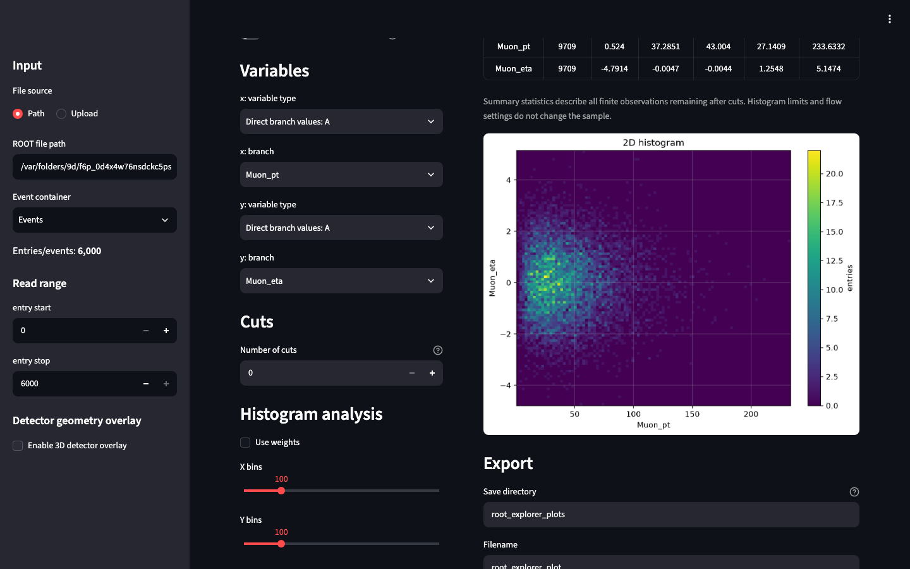

# Plotting ROOT data

After opening a ROOT file and selecting a TTree or RNTuple, use the **Plotter** tab to build a plot from one or more branches. For a first example, follow [Your first plot](../getting-started.md).

## Main plot types

ROOT Explorer supports **1D histograms**, **2D histograms**, and scatter plotting. Interactive three-dimensional scatter plots can be combined with a GDML geometry overlay when a suitable geometry file and coordinates are available. Some options depend on the selected plot type.

A 1D histogram counts observations in bins (or accumulates weights if weighting is selected). The x-axis represents the selected variable. For jagged particle values, the plotted population may be **objects** rather than **events**; see [Variables and collections](variables-and-collections.md).

A 2D histogram bins paired values on two axes. A scatter plot shows individual pairs, but display-oriented point limits/downsampling can apply to large samples. Do not interpret a downsampled scatter cloud as necessarily containing every selected observation.

## Make a plot

1. Choose the plot type.
2. Select the x variable (and the y variable if required), choosing a direct branch or a supported derived/reduced mode.
3. Configure any applicable cuts, weights, bin settings and plot style.
4. Click **Make plot** to generate the output.

The plot area continues displaying the **most recently generated plot** until you explicitly generate another. Changing widgets without clicking **Make plot** does not retroactively update the displayed result.

## Interpretation

**Selected entry range, cuts, finite-value filtering, weights, flow-bin handling and normalisation** can change the statistical meaning of the displayed histogram. A histogram density, weighted yield, and simple count distribution are not interchangeable. For precise definitions of weighted yields, statistical uncertainties, density normalisation and fit objectives, see [Histogram statistics, normalisation and fitting](histograms-and-fits.md).

Static plots can be downloaded and selected plotting configurations can be exported as standalone Python code. Retain a reproducible script for final physics results.

Next: [Variables and collections](variables-and-collections.md) or [ROOT objects](files-and-objects.md).
